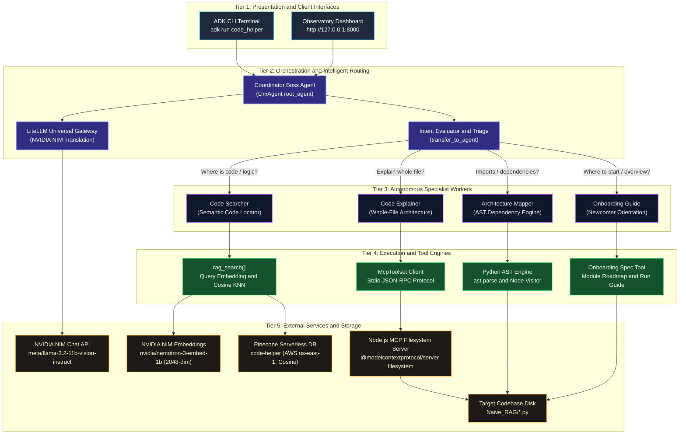

<div align="center">

# 🤖 Multi-Agent Code Helper

### *An Autonomous Hierarchical Multi-Agent System for Intelligent Codebase Exploration & Architectural Comprehension*

[](https://www.python.org/)
[](https://github.com/google/adk)
[](https://build.nvidia.com)
[](https://www.pinecone.io)
[](https://modelcontextprotocol.io)
[](https://github.com/tanishka-jadhav/CODE-HELPER-)

<p align="center">
  <a href="#in-simple-words">In Simple Words</a> •
  <a href="#executive-summary">Executive Summary</a> •
  <a href="#system-architecture">Agent Architecture</a> •
  <a href="#tools-catalog">Tools Catalog</a> •
  <a href="#rag-pipeline">5-Step RAG</a> •
  <a href="#chunking-strategy">Chunking Strategy</a> •
  <a href="#mcp-integration">MCP Integration</a> •
  <a href="#repository-layout">Repository Layout</a> •
  <a href="#quickstart">Quickstart</a> •
  <a href="#golden-evaluation">Benchmarks</a> •
  <a href="#engineering-fixes">Engineering Fixes</a> •
  <a href="#compliance-checklist">Compliance</a>
</p>

</div>

---

<a id="table-of-contents"></a>
## 📖 Table of Contents

1. [💡 In Simple Words: What is this project? (Quick 60-Second Guide)](#in-simple-words)
2. [🌟 Executive Summary](#executive-summary)
3. [🏛️ System Architecture & Multi-Agent Design](#system-architecture)
4. [🛠️ Comprehensive Tools Catalog](#tools-catalog)
5. [🔍 Manual 5-Step RAG Pipeline](#rag-pipeline)
6. [⚖️ Chunking Strategy & Why Naive RAG](#chunking-strategy)
7. [🔌 Model Context Protocol (MCP) Integration](#mcp-integration)
8. [📁 Repository Layout](#repository-layout)
9. [🚀 Quickstart & Execution Guide](#quickstart)
10. [📊 Golden Evaluation Showcase (Benchmark Results)](#golden-evaluation)
11. [🛡️ Engineering Challenges & Production Fixes](#engineering-fixes)
12. [✅ Student Guide Compliance Checklist](#compliance-checklist)

---

<a id="in-simple-words"></a>
## 1. 💡 In Simple Words: What is this project? (Quick 60-Second Guide)

> **Think of this system as an automated senior engineer helping you understand a new Python project.**

### The Problem
When a developer opens an unfamiliar repository, they waste hours asking:
* *"Where is this function located?"*
* *"What does this entire file do?"*
* *"Which files import `config.py`?"*
* *"Where do I start reading this code?"*

### The Solution: A Team of 5 AI Agents
Instead of one generic chatbot trying to guess everything, we have a **team with 1 Boss and 4 Specialists**:

| Agent | Real-World Role | What It Does | Tool Used |
| :--- | :--- | :--- | :--- |
| 👑 **Coordinator (Boss)** | *Project Manager* | Listens to your question and passes it to the right specialist. **Never answers directly.** | `transfer_to_agent` |
| 🔍 **Code Searcher** | *Search Engine* | Finds exact functions and lines in code using vector similarity. | `rag_search` (Custom 5-Step RAG + Pinecone) |
| 📖 **Code Explainer** | *Code Reviewer* | Reads a whole file safely and explains the architecture end-to-end. | `read_file`, `list_directory` (MCP Filesystem Server) |
| 📐 **Architecture Mapper** | *Code Inspector* | Checks imports and function outlines with **100% mathematical accuracy** (Zero AI guessing). | `find_import_dependencies`, `get_file_outline`, `get_codebase_tree` (Python AST) |
| 🧭 **Onboarding Guide** | *Mentor* | Welcomes new developers, explains what the project does, and gives the reading order. | `get_project_quickstart_and_modules` (Curated Knowledge Base) |

### The 3 Key Superpowers
1. **Manual 5-Step RAG (No LangChain/LlamaIndex)**: Built from scratch: `Read` ➔ `Split` (500 chars) ➔ `Embed` (NVIDIA NIM) ➔ `Store` (Pinecone) ➔ `Search`.
2. **Safe File Reading (MCP)**: Uses the official Model Context Protocol (`@modelcontextprotocol/server-filesystem`) to read files without risking system security.
3. **Zero-Hallucination AST Tools**: Code imports and structure are parsed using Python's built-in `ast` parser, so the AI never guesses or fabricates file connections.

---

<a id="executive-summary"></a>
## 2. 🌟 Executive Summary

**Multi-Agent Code Helper** is an intelligent developer assistant designed to onboard engineers and navigate Python codebases with high factual accuracy. Built using the **Google Agent Development Kit (ADK)**, **NVIDIA NIM** (via **LiteLLM**), and **Pinecone Serverless**, the system employs a disciplined hierarchy of **1 Coordinator Boss** and **4 specialized Worker agents** that handle code search, full-file explanation, structural dependency mapping, and newcomer orientation. Rather than relying on LLM guesswork, the team combines a manual 5-step semantic RAG engine, Model Context Protocol (MCP) sandboxed file access, and deterministic Python Abstract Syntax Tree (AST) analysis.

---

<a id="system-architecture"></a>
## 3. 🏛️ System Architecture & Multi-Agent Design

The Multi-Agent Code Helper is engineered using a **tiered, service-oriented multi-agent architecture** managed by the **Google Agent Development Kit (ADK)**. 

### Multi-Tier Architecture Diagram



### Architectural Principles & Layer Breakdown

1. **Presentation Tier (User Interfaces)**:
   - **ADK Terminal Runner (`adk run code_helper`)**: Direct stdin/stdout CLI REPL for developers in the console.
   - **Observatory Dashboard (`frontend/server.py`)**: The project's graphical dashboard on port 8080—featuring live agent flight telemetry, interactive chat, latency metrics, and real-time AST structure trees.

2. **Orchestration Tier (The Coordinator Boss)**:
   - **Invariant**: The Boss **never** answers technical questions directly.
   - **Triage Protocol**: Parses query semantics and invokes Google ADK's built-in `transfer_to_agent` mechanism to delegate control to exactly one worker.
   - **Shared Model Connection**: Uses a unified `LiteLlm` client pointing to NVIDIA NIM (`meta/llama-3.2-11b-vision-instruct`).

3. **Specialized Worker Tier**:
   - Each worker operates as a bounded agent with a dedicated instruction set.
   - **Agent Isolation**: Configured with `disallow_transfer_to_parent=True` and `disallow_transfer_to_peers=True` to prevent infinite delegation loops and ensure deterministic completion.

4. **Tool & Engine Tier**:
   - **Custom RAG Engine (`rag_search`)**: 5-step manual retrieval pipeline with a 0.72 similarity threshold and keyword validation guard.
   - **Deterministic AST Parser (`find_import_dependencies`, `get_file_outline`, `get_codebase_tree`)**: Uses Python's native `ast` and `pathlib` modules to inspect language grammar with 100% mathematical accuracy. Zero LLM guessing.
   - **Model Context Protocol Client (`file_tools`)**: Bridges the agent to the official `@modelcontextprotocol/server-filesystem` JSON-RPC stdio daemon.

5. **Persistence & Inference Tier**:
   - **Inference**: High-throughput inference via NVIDIA NIM REST endpoints.
   - **Vector Database**: Pinecone Serverless running on AWS `us-east-1` with 2048-dimensional vectors using the cosine similarity metric.
   - **Sandboxed Filesystem**: Read-only directory scoping strictly limited to the `Naive_RAG/` target codebase folder.

### Table of Agents

| Agent Name | Architectural Role | Assigned Tools | Example User Inquiries | Routing Criteria |
| :--- | :--- | :--- | :--- | :--- |
| **`coordinator`** | **Coordinator (Boss)** | `transfer_to_agent` | *"Any incoming question"* | Evaluates query semantics; delegates to one worker. Never generates direct answers. |
| **`code_searcher`** | **Specialized Worker** | `rag_search` | *"Where is document chunking implemented?"*<br/>*"Where are vectors normalized?"* | Targeted when user asks where specific functions, classes, or logic reside. |
| **`code_explainer`** | **Specialized Worker** | `read_file`, `list_directory` *(Filesystem MCP)* | *"Explain vector_store.py in detail."*<br/>*"Walk me through query_pipeline.py."* | Targeted when user asks to explain a whole file, module architecture, or script flow. |
| **`architecture_mapper`** | **Specialized Worker** | `find_import_dependencies`<br/>`get_file_outline`<br/>`get_codebase_tree` | *"Which files import config.py?"*<br/>*"Give me an outline of indexer.py."* | Targeted when user asks about imports, dependencies, AST outlines, or repository structure. |
| **`onboarding_guide`** | **Specialized Worker** | `get_project_quickstart_and_modules` | *"I am new to this project. Where do I start?"*<br/>*"How do I run this repo?"* | Targeted when user asks for getting-started orientation, reading orders, or overview commands. |

---
<a id="rag-pipeline"></a>
## 5. 🔍 Manual 5-Step RAG Pipeline

Built entirely from scratch in `code_helper/index_codebase.py` and `code_helper/tools/search_tools.py` **without LangChain or LlamaIndex**:

```text
[Target Codebase: Naive_RAG/*.py]
           │
           ▼
    ┌──────────────┐
    │ 1. READ      │  Scans Naive_RAG/*.py with UTF-8, capturing char & line counts
    └──────┬───────┘
           ▼
    ┌──────────────┐
    │ 2. SPLIT     │  Sliding window chunking (500 chars / 100 overlap) with exact line tracking
    └──────┬───────┘
           ▼
    ┌──────────────┐
    │ 3. EMBED     │  Batched embeddings via NVIDIA NIM (nvidia/nemotron-3-embed-1b, 2048 dims)
    └──────┬───────┘
           ▼
    ┌──────────────┐
    │ 4. STORE     │  Batch upsert to Pinecone Serverless (AWS us-east-1, Cosine Metric)
    └──────┬───────┘
           ▼
    ┌──────────────┐
    │ 5. SEARCH    │  Query embedding -> Pinecone top-k retrieval -> Keyword Grounding Guard
    └──────────────┘
```

1. **Step 1: Read (`read_codebase`)**: Traverses `Naive_RAG/` and reads every Python file (`config.py`, `indexer.py`, `vector_store.py`, `query_pipeline.py`, `main.py`).
2. **Step 2: Split (`split_into_chunks`)**: Slices files using a 500-character sliding window with 100-character overlap. Calculates exact source `start_line` and `end_line` for each chunk using newline offset tables.
3. **Step 3: Embed (`embed_chunks`)**: Transmits chunks in batches of 16 to NVIDIA NIM using the `nvidia/nemotron-3-embed-1b` model, generating 2048-dimensional dense vectors.
4. **Step 4: Store (`store_in_pinecone`)**: Batches and upserts records to Pinecone Serverless index (`code-helper`) on AWS `us-east-1`, persisting chunk text and line provenance in vector metadata.
5. **Step 5: Search (`rag_search`)**: Dynamically embeds user queries, calculates cosine nearest neighbors in Pinecone, filters results with grounding guards, and presents the relevant code snippets with line numbers.

---

<a id="chunking-strategy"></a>
## 6. ⚖️ Chunking Strategy & Why Naive RAG

### 📏 Simple Chunking Strategy (Easy to Explain)

The chunking mechanism uses a **character-level sliding window** with exact source line tracking:

* **Chunk Size: 500 characters** (~10 to 15 lines of Python code):
  * Matches the natural size of a typical Python function, class header, or logic block.
  * Small enough to remain semantically focused on a single task without diluting the embedding vector.
* **Chunk Overlap: 100 characters**:
  * Prevents boundary cut-offs. If a function header or docstring ends near the 500-character mark, the 100-character overlap ensures it is captured intact in the next chunk.
* **Exact Line Provenance**:
  * Every chunk records its source file, `start_line`, and `end_line` metadata in Pinecone, enabling the agent to cite exact code locations in its answers.

---

### 🔍 Why Naive RAG Compared to Other RAG Architectures?

There are several paradigms of RAG in modern AI: **Naive RAG**, **Advanced RAG (HyDE / Multi-Query)**, and **GraphRAG**. Here is why we chose **Naive RAG** for this project:

| RAG Pattern | How It Works | Why We Did or Didn't Use It |
| :--- | :--- | :--- |
| **Naive RAG** *(Our Choice)* | **Index ➔ Embed ➔ Search ➔ Generate**.<br/>Direct cosine similarity retrieval from Pinecone. | ✅ **Best Fit**: Fast, lightweight, and deterministic. Gives exact code locations in milliseconds with minimal API cost and zero extra latency. |
| **Advanced RAG** *(HyDE / Multi-Query)* | Generates multiple hypothetical answers or re-writes questions using an LLM before searching. | ❌ **Unnecessary Overhead**: Generating 3 extra queries adds 5–10 seconds of latency and burns extra tokens, without improving search accuracy for concrete code functions. |
| **GraphRAG** *(Knowledge Graphs)* | Uses an LLM to extract entity-relationship graphs (nodes and edges) from text. | ❌ **Heavy & Expensive**: Overkill for code dependencies. We already have **Python's native AST parser**, which extracts imports and relationships with **100% mathematical accuracy** without needing an expensive knowledge graph. |
| **Modular / Agentic RAG** *(Our Architecture)* | Pairs a lightweight Naive RAG search with an intelligent multi-agent coordinator (Google ADK). | ✅ **The Real Win**: Instead of overcomplicating the RAG pipeline itself, the **Boss Agent** intelligently decides *when* to use Naive RAG (for code search) and *when* to bypass it entirely (using AST for architecture, or MCP for whole-file reading). |

---

<a id="mcp-integration"></a>
## 7. 🔌 Model Context Protocol (MCP) Integration

The **Code Explainer** agent utilizes the **Model Context Protocol (MCP)** via `@modelcontextprotocol/server-filesystem` executed by `npx`.

```python
# code_helper/agent.py
file_tools = McpToolset(
    connection_params=StdioConnectionParams(
        server_params=StdioServerParameters(
            command=shutil.which("npx") or "npx",
            args=["-y", "@modelcontextprotocol/server-filesystem", target_codebase_str],
        ),
        timeout=30,
    ),
    tool_filter=["list_directory", "read_file"],
)
```

### Why MCP Was Chosen
- **Industry Standard**: MCP is the open standard protocol for bidirectional tool communication with language models over JSON-RPC stdio.
- **Sandboxed Security**: Rather than allowing unrestricted filesystem operations across the host OS, the MCP server is launched with a directory scope strictly restricted to the `Naive_RAG/` codebase folder.
- **Unchunked Holistic Context**: While RAG is optimal for pinpointing functions, code explanation requires reviewing full files end-to-end. MCP enables the agent to fetch complete source files on-demand.

---
<a id="tools-catalog"></a>
## 4. 🛠️ Comprehensive Tools Catalog

Per assignment specifications:
- ✅ **At least 5 custom tools are built** (6 custom tools total, excluding MCP server built-in tools).
- ✅ **At least one tool uses no AI** (4 tools run plain deterministic Python standard library).
- ✅ **Filesystem MCP server tools do not count toward the custom 5.**

| Tool Function | Implementation Engine | Technology | AI vs Plain Python | Worker Owner | Purpose & Output Contract |
| :--- | :--- | :--- | :---: | :--- | :--- |
| **`rag_search`** | NVIDIA NIM + Pinecone | `openai`, `pinecone` | **AI** (Vectors) | `code_searcher` | Converts queries to 2048-d vectors via `nvidia/nemotron-3-embed-1b`, retrieves top-k chunks from Pinecone, checks keyword grounding, and formats output with file paths and line ranges. |
| **`find_import_dependencies`** | Python Syntax Tree | `ast` standard lib | **Plain Python (No AI)** | `architecture_mapper` | Statically parses AST `Import` and `ImportFrom` nodes across every `.py` file to locate exact dependencies and line numbers. Zero hallucination. |
| **`get_file_outline`** | Python Syntax Tree | `ast` standard lib | **Plain Python (No AI)** | `architecture_mapper` | Extracts class definitions, methods, functions, and their line ranges from source code. |
| **`get_codebase_tree`** | Filesystem Traversal | `pathlib` standard lib | **Plain Python (No AI)** | `architecture_mapper` | Statically scans and lists all tracked Python files in the target codebase. |
| **`get_project_quickstart_and_modules`** | Curated Knowledge Base | Standard Python | **Plain Python (No AI)** | `onboarding_guide` | Delivers the recommended reading sequence, purpose of each module, and CLI invocation commands. |
| **`read_code_file`** | Sandboxed IO Reader | `pathlib`, `io` | **Plain Python (No AI)** | Standalone / Offline | Direct sandboxed full-file reader with line numbers used for offline verification before MCP integration. |
| **`read_file`** *(MCP)* | Stdio JSON-RPC | `@modelcontextprotocol/server-filesystem` | **MCP Protocol** | `code_explainer` | Reads full, unchunked source files through the official Model Context Protocol server. |
| **`list_directory`** *(MCP)* | Stdio JSON-RPC | `@modelcontextprotocol/server-filesystem` | **MCP Protocol** | `code_explainer` | Lists directory contents through the official Model Context Protocol server. |

---


<a id="repository-layout"></a>
## 8. 📁 Repository Layout

```text
DEBO ASSIGNMENT 2/
├── .env                              <- API keys and secrets (Never committed; in .gitignore)
├── .env.example                      <- Environment template for quick setup
├── .gitignore                        <- Ignores .env, virtual environments, caches
├── PROJECT_EXPLANATION.md            <- Complete master guide for students & viva defense
├── README.md                         <- Comprehensive project documentation
├── notes.md                          <- Presentation & viva defense spoken notes
├── requirements.txt                  <- Dependencies: google-adk, litellm, pinecone, mcp, openai
│
├── code_helper/                      <- Main ADK Multi-Agent Package
│   ├── __init__.py                   <- Package entry point; environment sync
│   ├── agent.py                      <- Coordinator Boss & 4 Worker definitions
│   ├── config.py                     <- Centralized configuration container
│   ├── index_codebase.py             <- Offline 5-stage RAG indexer (Pinecone)
│   └── tools/                        <- Custom tools
│       ├── __init__.py               <- Exports tool functions
│       ├── ast_tools.py              <- Plain Python AST tools (dependencies, outlines)
│       ├── file_tools.py             <- Sandboxed direct file reader
│       ├── onboarding_tools.py       <- New developer quickstart & reading order
│       └── search_tools.py           <- RAG search tool with Pinecone & NVIDIA NIM
│
├── Naive_RAG/                        <- Target Python codebase being analyzed
│   ├── config.py                     <- Target codebase settings
│   ├── indexer.py                    <- Target codebase indexing logic
│   ├── main.py                       <- Target codebase entry point
│   ├── query_pipeline.py             <- Target codebase query pipeline
│   └── vector_store.py               <- Target codebase vector storage
│
├── frontend/                         <- Multi-Agent Observatory Web UI
│   ├── server.py                     <- FastAPI server for agent interaction & telemetry
│   └── static/                       <- Modern dark-mode web application (HTML/CSS/JS)
│
└── tests/                            <- Verification & Benchmark Suites
    ├── benchmark_results.json        <- Golden evaluation benchmark recordings
    ├── test_all_workers.py           <- Unit tests for each worker agent
    ├── test_architecture_mapper.py   <- AST parsing and dependency mapping tests
    ├── test_boss_routing.py          <- Coordinator routing logic tests
    ├── test_code_searcher.py         <- RAG retrieval tests
    ├── test_embeddings.py            <- NVIDIA NIM embedding connectivity tests
    ├── test_full_system.py           <- End-to-end integration tests
    ├── test_golden_questions.py      <- Canonical 5-question automated evaluation runner
    ├── test_mcp.py                   <- Filesystem MCP server connectivity tests
    ├── test_pinecone.py              <- Pinecone Serverless connection & upsert tests
    └── test_retrieval.py             <- Semantic similarity validation tests
```

---

<a id="quickstart"></a>
## 9. 🚀 Quickstart & Execution Guide

### Prerequisites
- **Python**: 3.10 or higher
- **Node.js**: v18+ installed (`node -v` to verify)
- **NVIDIA NIM API Key**: Obtain from [build.nvidia.com](https://build.nvidia.com)
- **Pinecone API Key**: Obtain from [pinecone.io](https://www.pinecone.io)

### 1. Installation

```powershell
# Clone the repository
git clone https://github.com/tanishka-jadhav/CODE-HELPER-.git
cd "CODE-HELPER-"

# Create virtual environment
python -m venv venv

# Activate virtual environment:
# Windows PowerShell:
.\venv\Scripts\Activate.ps1
# Windows Command Prompt (CMD):
venv\Scripts\activate.bat
# macOS / Linux:
source venv/bin/activate

# Upgrade pip and install dependencies
pip install --upgrade pip
pip install -r requirements.txt
```

> [!TIP]
> **Windows PowerShell Execution Policy Note:**  
> If PowerShell reports `PSSecurityException` when running `Activate.ps1`, run:  
> `Set-ExecutionPolicy -Scope Process -ExecutionPolicy Bypass`  
> or call `.\venv\Scripts\python.exe` directly.

### 2. Configure Credentials

Copy the template file to `.env`:

```powershell
# Windows PowerShell:
Copy-Item .env.example .env

# Windows Command Prompt (CMD):
copy .env.example .env

# macOS / Linux:
cp .env.example .env
```

Edit `.env` with your API keys:

```env
NVIDIA_API_KEY=nvapi-your-key-here
NVIDIA_NIM_API_KEY=nvapi-your-key-here
NVIDIA_BASE_URL=https://integrate.api.nvidia.com/v1
NVIDIA_CHAT_MODEL=meta/llama-3.2-11b-vision-instruct
NVIDIA_EMBED_MODEL=nvidia/nemotron-3-embed-1b

PINECONE_API_KEY=your-pinecone-key
PINECONE_INDEX_NAME=code-helper
PINECONE_CLOUD=aws
PINECONE_REGION=us-east-1

PYTHONUTF8=1
```

### 3. Step 1: Run Offline Indexing (One-Time Setup)

Indexes all `.py` files in `Naive_RAG/` into Pinecone Serverless:

```powershell
python code_helper/index_codebase.py
```

### 4. Step 2: Run the Helper

You can interact with the Multi-Agent Code Helper via either the interactive terminal or the graphical web dashboard:

#### Option A: Terminal Interactive Mode
```powershell
adk run code_helper
```
*(Direct command-line session where you can chat with the Coordinator Boss and watch it delegate to specialist workers).*

#### Option B: Observatory Web Dashboard (Recommended)
```powershell
python frontend/server.py
```
*(Open `http://localhost:8080` to launch the full graphical dashboard featuring live multi-agent flight tracking, interactive chat, latency telemetry, and dynamic AST codebase exploration).*

> [!TIP]
> **Google ADK SDK Native Graph**: If you want to view Google ADK's raw internal session state graph, you can also run `adk web` on `http://localhost:8000`.

### 5. Step 3: Run the Test & Evaluation Benchmark

```powershell
# Run the automated 5-question golden benchmark
python tests/test_golden_questions.py

# Run the comprehensive unit test suite
python -m pytest tests/
```

---

<a id="golden-evaluation"></a>
## 10. 📊 Golden Evaluation Showcase (Benchmark Results)

Recorded directly from automated execution of `tests/test_golden_questions.py` (persisted in `tests/benchmark_results.json`):

<details open>
<summary><b>1. Code Search: "Where is the document chunking logic implemented?"</b></summary>

* **Routed Worker**: `code_searcher`
* **Tools Invoked**: `transfer_to_agent`, `rag_search`
* **Execution Time**: ~45.0s
* **Evaluation Match**: ✅ Passed (Pinpointed exact file and line ranges)
* **Model Response**:
```text
File: Naive_RAG/indexer.py
Lines: 240-264
Code:
    # 1. Ingestion
    raw_document = load_document(file_path=file_path)

    # 2. Chunking
    chunk_list = chunk_document(
        text=raw_document,
        chunk_size=config.chunk_size,
        chunk_overlap=config.chunk_overlap,
    )

    # 3. Embedding
    embedded_chunks = embed_chunks(
        chunks=chunk_list,
        config=config,
    )
```
</details>

<details open>
<summary><b>2. Architecture Mapping: "Which files import config.py?"</b></summary>

* **Routed Worker**: `architecture_mapper`
* **Tools Invoked**: `transfer_to_agent`, `find_import_dependencies`
* **Execution Time**: ~4.5s
* **Evaluation Match**: ✅ Passed (Exact AST analysis without AI guessing)
* **Model Response**:
```text
Files that import 'config':
- indexer.py (Line 26)
- main.py (Line 31)
- query_pipeline.py (Line 23)
- vector_store.py (Line 22)

[DEPENDENCY SEARCH COMPLETE]: Report these matching files directly to the user.
```
</details>

<details open>
<summary><b>3. Onboarding Guide: "I am new to this project. Where do I start?"</b></summary>

* **Routed Worker**: `onboarding_guide`
* **Tools Invoked**: `transfer_to_agent`, `get_project_quickstart_and_modules`
* **Execution Time**: ~23.8s
* **Evaluation Match**: ✅ Passed (Authoritative orientation & reading order)
* **Model Response**:
```text
Naive_RAG Project Onboarding Guide:
1. Purpose: A reference 8-stage RAG system using NVIDIA NIM and Pinecone.
2. Recommended Reading Order:
   - config.py (Settings & credentials)
   - indexer.py (Offline indexing: Read -> Split -> Embed -> Store)
   - vector_store.py (Pinecone client and cosine similarity)
   - query_pipeline.py (Online query: Embed -> Retrieve -> Augment -> Generate)
   - main.py (Interactive CLI demonstration)
3. Run Commands:
   - Full Demo: python main.py
   - Indexing Only: python main.py --index
   - Custom Query: python main.py --query '<question>'
   - Compare: python main.py --compare
```
</details>

<details open>
<summary><b>4. Code Explainer: "Explain vector_store.py in detail."</b></summary>

* **Routed Worker**: `code_explainer`
* **Tools Invoked**: `transfer_to_agent`, `read_file` *(Filesystem MCP)*
* **Execution Time**: ~23.1s
* **Evaluation Match**: ✅ Passed (Complete architectural breakdown via MCP)
* **Model Response**:
```text
The vector_store.py file is a Python module that provides an interface to manage vector databases using Pinecone Serverless. It includes functions for initializing, upserting, and querying vector embeddings, with a local fallback to a transparent JSON vector store.

Core functions:
- calculate_cosine_similarity: Calculates cosine similarity between two vectors using basic math (dot products and Euclidean norms).
- get_pinecone_client: Instantiates and returns the modern Pinecone client.
- ensure_pinecone_index_exists: Validates that the Pinecone Serverless index exists, creating it if necessary.
- upsert_to_vector_db: Batches and stores chunk embeddings and metadata into Pinecone or local fallback.
- query_vector_db: Retrieves top-k most similar chunks for a query vector.
```
</details>

<details open>
<summary><b>5. Negative Grounding: "Where is Stripe payment billing handled?"</b></summary>

* **Routed Worker**: `code_searcher`
* **Tools Invoked**: `transfer_to_agent`, `rag_search`
* **Execution Time**: ~7.5s
* **Evaluation Match**: ✅ Passed (Refused to hallucinate non-existent features)
* **Model Response**:
```text
I could not find that in the codebase.
```
</details>

---

<a id="engineering-fixes"></a>
## 11. 🛡️ Engineering Challenges & Production Fixes

### 1. Windows UTF-8 Terminal Encoding (`UnicodeDecodeError`)
* **Problem**: Running on Windows with the default `cp1252` encoding triggered `UnicodeDecodeError: 'charmap' codec can't decode byte 0x9d...` when streaming LLM responses or printing file paths containing UTF-8 characters.
* **Fix**: Configured `PYTHONUTF8=1` in `.env` and introduced defensive stream reconfiguration in all CLI runners:
  ```python
  if sys.stdout and hasattr(sys.stdout, "reconfigure"):
      sys.stdout.reconfigure(encoding="utf-8", errors="replace")
  ```

### 2. LiteLLM Environment Variable Key Synchronization
* **Problem**: LiteLLM specifically resolves NVIDIA NIM authentication under `NVIDIA_NIM_API_KEY`, whereas the NVIDIA developer portal standard uses `NVIDIA_API_KEY`. Missing either variable caused authentication crashes in `google-adk`.
* **Fix**: Implemented a bidirectional key synchronizer in `code_helper/config.py` and `code_helper/__init__.py` that automatically detects, validates, and mirrors keys between `NVIDIA_API_KEY` and `NVIDIA_NIM_API_KEY`.

### 3. Agent Tool-Calling Infinite Loops
* **Problem**: Worker agents would occasionally call their assigned tools multiple times consecutively instead of synthesizing a final textual response after receiving tool output.
* **Fix**:
  1. Set strict prompt constraints: `"Call tool EXACTLY ONCE. As soon as the tool returns, formulate your final answer immediately."`
  2. Applied agent isolation: `disallow_transfer_to_parent=True` and `disallow_transfer_to_peers=True` on all workers.
  3. Added an automated execution safety guard in benchmark runners that halts loops once the target tool has returned data.

### 4. Hallucination on Out-of-Scope Code Questions
* **Problem**: When asked about features not in the codebase (e.g., Stripe billing), Pinecone still returns the mathematical nearest neighbors. Without a grounding guard, the model attempted to connect unrelated code to the query.
* **Fix**: Added a keyword grounding check and similarity threshold (`0.72`) in `rag_search`. If query keywords are missing from retrieved chunks and the similarity score is below the threshold, the tool explicitly returns `"No relevant code passages found in the codebase."`, and the worker answers `"I could not find that in the codebase."`

---

<a id="compliance-checklist"></a>
## 12. ✅ Student Guide Compliance Checklist

| Guide Requirement | Implementation Detail | Status |
| :--- | :--- | :---: |
| **1 Boss that only routes** | `coordinator` agent uses `transfer_to_agent` and never answers code questions directly | ✅ **Verified** |
| **4 Workers with clear descriptions** | `code_searcher`, `code_explainer`, `architecture_mapper`, `onboarding_guide` | ✅ **Verified** |
| **5 or more tools, 1 with no AI** | 6 custom tools implemented; 4 tools run plain deterministic Python (`ast`, `pathlib`) | ✅ **Verified** |
| **Your own RAG, all 5 steps** | Manual 5-stage pipeline: Read, Split, Embed, Store, Search (No LangChain/LlamaIndex) | ✅ **Verified** |
| **Filesystem MCP on Code Explainer** | `@modelcontextprotocol/server-filesystem` via `npx` with `read_file` & `list_directory` | ✅ **Verified** |
| **Chunking explained in README** | Detailed rationale for 500-char / 100-overlap chunks and comparison with other RAG patterns | ✅ **Verified** |
| **Keys in .env, not in the code** | Isolated in `.env`, guarded by `.gitignore`, with template provided in `.env.example` | ✅ **Verified** |
| **Runs with `adk run` or `adk web`** | Verified on ADK CLI terminal runner and custom Observatory dashboard (`adk web` compatible) | ✅ **Verified** |
| **3 sample questions & problem fix** | 5 benchmarked evaluations with recorded outputs and 4 documented problem fixes | ✅ **Verified** |

---

<div align="center">
  <sub>Built with ❤️ using Google ADK, NVIDIA NIM, and Pinecone Serverless.</sub>
</div>
