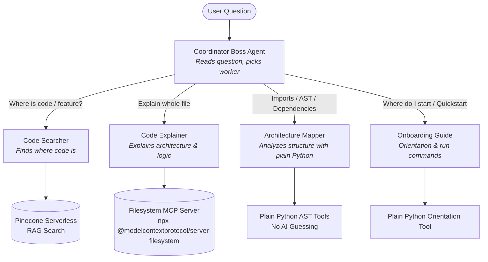

# Multi-Agent Code Helper

[](https://www.python.org/downloads/)
[](https://github.com/google/adk)
[](https://build.nvidia.com)
[](https://www.pinecone.io)
[](https://modelcontextprotocol.io)

---

## 1. Project Overview

**Multi-Agent Code Helper** is an autonomous multi-agent developer assistant engineered to explore, analyze, and explain codebases with high precision. Built using the **Google Agent Development Kit (ADK)**, **NVIDIA NIM** (via **LiteLLM**), and **Pinecone Serverless**, the system employs a hierarchical architecture consisting of **1 Coordinator Boss** and **4 specialized Worker agents**. Rather than guessing, the team combines a custom manual 5-step RAG pipeline, Model Context Protocol (MCP) filesystem inspection, and deterministic Python AST analysis to answer technical questions accurately.

---

## 2. Agent Team Architecture

The system implements the coordinator-worker design pattern specified in the Student Guide. The **Boss (`coordinator`)** only routes incoming inquiries and never answers technical questions directly. Each **Worker** possesses focused instructions, dedicated tooling, and bounded execution scopes.



### Table of Agents

| Agent Name | Role / Description | Assigned Tools | Example Question |
| :--- | :--- | :--- | :--- |
| **`coordinator`** *(Boss)* | Evaluates user intent and routes to the best worker agent. Never answers code queries itself. | `transfer_to_agent` | *"Any incoming query"* |
| **`code_searcher`** *(Worker)* | Finds files, exact line numbers, and implementation snippets for requested features using RAG. | `rag_search` | *"Where is the document chunking logic implemented?"* |
| **`code_explainer`** *(Worker)* | Reads whole files in the codebase and provides in-depth technical explanations. | `list_directory`, `read_file` *(via Filesystem MCP)* | *"Explain vector_store.py in detail."* |
| **`architecture_mapper`** *(Worker)* | Statically parses Python AST trees to extract imports, dependencies, class hierarchies, and file trees. | `find_import_dependencies`, `get_file_outline`, `get_codebase_tree` | *"Which files import config.py?"* |
| **`onboarding_guide`** *(Worker)* | Provides project orientation, explaining purpose, file reading order, and CLI commands. | `get_project_quickstart_and_modules` | *"I am new to this project. Where do I start?"* |

---

## 3. Tools Specification

Per the Student Guide rules:
- **At least 5 custom tools are built** (6 custom tools total, excluding MCP server built-in tools).
- **At least one tool uses no AI** (4 tools run plain deterministic Python).
- **Filesystem MCP server tools do not count toward the 5 custom tools.**

### Table of Tools

| Tool Function | Engine / Implementation | AI vs Plain Python | Assigned Agent | What It Does |
| :--- | :--- | :--- | :--- | :--- |
| **`rag_search`** | NVIDIA NIM + Pinecone | **AI** (Vector Search) | `code_searcher` | Embeds the search query with `nvidia/nemotron-3-embed-1b` and retrieves top-k matching code snippets with file names and line ranges from Pinecone Serverless. |
| **`find_import_dependencies`** | Python `ast` module | **Plain Python (No AI)** | `architecture_mapper` | Statically parses AST `Import` and `ImportFrom` nodes across all repository `.py` files to identify exact files and lines that import a given module. |
| **`get_file_outline`** | Python `ast` module | **Plain Python (No AI)** | `architecture_mapper` | Extracts class definitions, methods, functions, and line ranges directly from the Python syntax tree. Zero AI hallucination. |
| **`get_codebase_tree`** | Python `pathlib` | **Plain Python (No AI)** | `architecture_mapper` | Generates a deterministic file directory map of Python files in the target codebase. |
| **`get_project_quickstart_and_modules`** | Standard Python | **Plain Python (No AI)** | `onboarding_guide` | Returns structured project purpose, recommended file reading sequence, and primary CLI commands. |
| **`read_code_file`** | Sandboxed `io` | **Plain Python (No AI)** | Standalone / Offline | Direct sandboxed full-file reader with line numbers for local validation prior to MCP connection. |
| **`read_file`** *(MCP)* | Stdio MCP Protocol | **MCP Server Tool** | `code_explainer` | Reads complete, unchunked source files from the filesystem via `@modelcontextprotocol/server-filesystem`. |
| **`list_directory`** *(MCP)* | Stdio MCP Protocol | **MCP Server Tool** | `code_explainer` | Lists directory contents through the Filesystem MCP server. |

---

## 4. Manual 5-Step RAG Pipeline (No LangChain, No LlamaIndex)

The search pipeline is implemented from scratch in `code_helper/index_codebase.py` and `code_helper/tools/search_tools.py` without third-party agent orchestration frameworks:

```
[Target Codebase: Naive_RAG/*.py]
           │
           ▼
    1. READ        --> Ingests all .py files with UTF-8 encoding & line counts
           │
           ▼
    2. SPLIT       --> Sliding window chunking (500 chars, 100 overlap) with line-offset mapping
           │
           ▼
    3. EMBED       --> Batch embedding via NVIDIA NIM (nvidia/nemotron-3-embed-1b, 2048 dims)
           │
           ▼
    4. STORE       --> Upserts vector embeddings + text + line provenance to Pinecone Serverless
           │
           ▼
    5. SEARCH      --> Query embedding -> Pinecone Cosine Similarity Search -> Keyword grounding
```

1. **Read (`read_codebase`)**: Traverses `Naive_RAG/` and reads each Python file (`config.py`, `indexer.py`, `vector_store.py`, `query_pipeline.py`, `main.py`).
2. **Split (`split_into_chunks`)**: Slices code into discrete character chunks with overlapping boundaries, mapping exact start and end line numbers using precomputed newline offsets.
3. **Embed (`embed_chunks`)**: Transmits chunk texts in batches of 16 to NVIDIA NIM REST API using `nvidia/nemotron-3-embed-1b` (2048 dimensions).
4. **Store (`store_in_pinecone`)**: Batches and upserts records to Pinecone Serverless (AWS `us-east-1`, cosine metric) with metadata: `file_name`, `file_path`, `start_line`, `end_line`, and `text`.
5. **Search (`rag_search`)**: Embeds the user's query via NVIDIA NIM, performs cosine top-k retrieval in Pinecone, applies keyword grounding filters, and formats provenance blocks.

---

## 5. Chunk Size Decision & Hyperparameter Analysis

* **Selected Configuration**:
  * **Chunk Size**: `500` characters
  * **Chunk Overlap**: `100` characters
  * **Effective Stride**: `400` characters

### Why 500 Characters with 100 Character Overlap?
Code differs fundamentally from natural language prose. Python functions, class declarations, and import blocks are typically between 200 and 600 characters:
- **Comparison with Small Chunks (e.g., 200 characters / 40 overlap)**:
  * *Disadvantage*: Too fine-grained. Splits function signatures from their docstrings or bodies, breaking semantic unity. The embedding captures only fragments, yielding poor similarity matches.
- **Comparison with Large Chunks (e.g., 1500 characters / 300 overlap)**:
  * *Disadvantage*: Too coarse. Multiple independent functions or classes merge into a single chunk. The embedding vector averages diverse concepts, diluting cosine similarity scores and returning excessive irrelevant code to the LLM.
- **The 500 / 100 Sweet Spot**:
  * In `Naive_RAG`, functions such as `load_document()`, `calculate_cosine_similarity()`, or configuration blocks naturally span 300–500 characters.
  * The 100-character overlap ensures that function headers, docstrings, or cross-boundary variable definitions are not cut off at chunk boundaries.

---

## 6. Model Context Protocol (MCP) Integration

The **Code Explainer** agent uses the **Model Context Protocol Filesystem Server** (`@modelcontextprotocol/server-filesystem` via `npx`).

### Why MCP was Used
1. **Open Standard**: MCP provides a standardized protocol for connecting AI agents to local and external tools over JSON-RPC stdio.
2. **Sandboxed File Access**: Rather than granting unrestricted OS disk access, the MCP server is initialized with a strict path argument pointing exclusively to the target codebase (`Naive_RAG`).
3. **Whole-File Architectural Analysis**: RAG search cuts code into chunks, which is ideal for finding specific functions. However, explaining overall module architecture requires reading the complete file without fragmentation. The MCP server provides native `read_file` and `list_directory` capabilities directly to the agent.

---

## 7. Setup & Execution Commands

### Prerequisites
- Python 3.10+
- Node.js (v18+ recommended; run `node -v` to verify)
- NVIDIA NIM API Key ([build.nvidia.com](https://build.nvidia.com))
- Pinecone API Key ([pinecone.io](https://www.pinecone.io))

### 1. Clone & Set Up Virtual Environment
```bash
# Clone repository
git clone <your-repo-url>
cd "DEBO ASSIGNMENT 2"

# Create virtual environment
python -m venv venv

# Activate virtual environment
# On Windows PowerShell:
.\venv\Scripts\Activate.ps1
# On Linux/macOS:
source venv/bin/activate

# Install dependencies
pip install -r requirements.txt
```

### 2. Configure Environment Keys
Create a `.env` file in the project root (never commit this file):
```bash
# Windows PowerShell
Copy-Item .env.example .env
```
Populate `.env` with your API credentials:
```env
NVIDIA_API_KEY=nvapi-your-nvidia-key
NVIDIA_NIM_API_KEY=nvapi-your-nvidia-key
NVIDIA_BASE_URL=https://integrate.api.nvidia.com/v1
NVIDIA_CHAT_MODEL=meta/llama-3.2-11b-vision-instruct
NVIDIA_EMBED_MODEL=nvidia/nemotron-3-embed-1b

PINECONE_API_KEY=your-pinecone-key
PINECONE_INDEX_NAME=code-helper
PINECONE_CLOUD=aws
PINECONE_REGION=us-east-1

PYTHONUTF8=1
```

### 3. Run RAG Indexing (One-Time Execution)
Populates the Pinecone vector index with code chunks:
```bash
python code_helper/index_codebase.py
```

### 4. Run the Helper
**Option A: Terminal Interactive Mode**
```bash
adk run code_helper
```

**Option B: ADK Web GUI**
```bash
adk web
```
*(Open your browser at `http://localhost:8000` to interact with the visual agent graph).*

**Option C: Run Benchmark Evaluation Suite**
```bash
python tests/test_golden_questions.py
```

---

## 8. Sample Questions and Evaluation Results

The following queries were executed through the `coordinator` agent. The outputs below reflect real responses recorded during automated benchmarking (`tests/benchmark_results.json`):

### Question 1: Code Search
* **User Query**: *"Where is the document chunking logic implemented?"*
* **Routed Worker**: `code_searcher`
* **Tools Used**: `transfer_to_agent`, `rag_search`
* **Answer**:
```text
File: Naive_RAG/indexer.py
Lines: 240-264
Code:
    # 1. Ingestion
    raw_document = load_document(file_path=file_path)

    # 2. Chunking
    chunk_list = chunk_document(
        text=raw_document,
        chunk_size=config.chunk_size,
        chunk_overlap=config.chunk_overlap,
    )
```

### Question 2: Architecture Mapping
* **User Query**: *"Which files import config.py?"*
* **Routed Worker**: `architecture_mapper`
* **Tools Used**: `transfer_to_agent`, `find_import_dependencies`
* **Answer**:
```text
Files that import 'config':
- indexer.py (Line 26)
- main.py (Line 31)
- query_pipeline.py (Line 23)
- vector_store.py (Line 22)
```

### Question 3: Onboarding Guide
* **User Query**: *"I am new to this project. Where do I start?"*
* **Routed Worker**: `onboarding_guide`
* **Tools Used**: `transfer_to_agent`, `get_project_quickstart_and_modules`
* **Answer**:
```text
Naive_RAG Project Onboarding Guide:
1. Purpose: A reference 8-stage RAG system using NVIDIA NIM and Pinecone.
2. Recommended Reading Order:
   - config.py (Settings & credentials)
   - indexer.py (Offline indexing: Read -> Split -> Embed -> Store)
   - vector_store.py (Pinecone client and cosine similarity)
   - query_pipeline.py (Online query: Embed -> Retrieve -> Augment -> Generate)
   - main.py (Interactive CLI demonstration)
3. Run Commands:
   - Full Demo: python main.py
   - Indexing Only: python main.py --index
   - Custom Query: python main.py --query '<question>'
   - Compare: python main.py --compare
```

### Question 4: Code Explanation
* **User Query**: *"Explain vector_store.py in detail."*
* **Routed Worker**: `code_explainer`
* **Tools Used**: `transfer_to_agent`, `read_file` *(Filesystem MCP)*
* **Answer**:
```text
vector_store.py provides an interface to manage vector databases using Pinecone Serverless. It includes functions for initializing, upserting, and querying vector embeddings, with a local fallback to a JSON vector store.

Key components:
- calculate_cosine_similarity: Computes cosine similarity between vectors using dot products and norms.
- get_pinecone_client: Instantiates the Pinecone client.
- ensure_pinecone_index_exists: Validates that the Serverless index is present or creates it.
- upsert_to_vector_db: Batches and uploads vector embeddings and metadata.
- query_vector_db: Queries top-k most similar chunks for query vectors.
```

### Question 5: Negative Grounding / Hallucination Prevention
* **User Query**: *"Where is Stripe payment billing handled?"*
* **Routed Worker**: `code_searcher`
* **Tools Used**: `transfer_to_agent`, `rag_search`
* **Answer**:
```text
I could not find that in the codebase.
```

---

## 9. Problems Encountered & Fixes Applied

### Problem 1: Windows UTF-8 Terminal Encoding Error (`UnicodeDecodeError`)
* **Symptom**: On Windows 11 with default `cp1252` encoding, printing special characters or inspecting files containing UTF-8 characters caused `UnicodeDecodeError: 'charmap' codec can't decode byte...`.
* **Fix**: Added `PYTHONUTF8=1` in `.env` and introduced defensive stream reconfiguration in entry points:
  ```python
  if sys.stdout and hasattr(sys.stdout, "reconfigure"):
      sys.stdout.reconfigure(encoding="utf-8", errors="replace")
  ```

### Problem 2: LiteLLM vs. Standard NVIDIA Key Environment Variable Mismatch
* **Symptom**: LiteLLM specifically requires `NVIDIA_NIM_API_KEY`, while the NVIDIA developer portal standard specifies `NVIDIA_API_KEY`. Missing either variable caused authentication failures during agent initialization.
* **Fix**: Built an automatic synchronization shim in `code_helper/config.py` and `code_helper/__init__.py` that mirrors valid keys between `NVIDIA_API_KEY` and `NVIDIA_NIM_API_KEY`.

### Problem 3: Agent Repeated Tool Calling Loops
* **Symptom**: Under Google ADK, LLM agents would occasionally call the same tool repeatedly instead of returning the final textual answer to the user.
* **Fix**:
  1. Configured strict prompt instructions (`"Call tool EXACTLY ONCE"`, `"Deliver final answer directly"`).
  2. Configured agent isolation: `disallow_transfer_to_parent=True` and `disallow_transfer_to_peers=True` on worker agents.
  3. Added an execution safety circuit breaker in the benchmark harness to halt processing once target tools complete.

### Problem 4: Model Hallucination on Non-Existent Code Concepts
* **Symptom**: When queried about features absent from the codebase (e.g., Stripe payments), vector databases still return nearest cosine neighbors. Without a grounding guard, the LLM attempted to associate unrelated chunks with the query.
* **Fix**: Added a keyword grounding check and similarity threshold (`0.72`) in `code_helper/tools/search_tools.py`. If query terms do not appear and similarity is below the threshold, the tool explicitly returns `"No relevant code passages found in the codebase"`, prompting the searcher to respond `"I could not find that in the codebase."`

---

## 10. Final Verification Checklist

| Requirement | Implementation Detail | Status |
| :--- | :--- | :---: |
| **1 Boss that only routes** | `coordinator` agent uses `transfer_to_agent` and never answers directly | Verified |
| **4 Workers with clear descriptions** | `code_searcher`, `code_explainer`, `architecture_mapper`, `onboarding_guide` | Verified |
| **5 or more tools, 1 with no AI** | 6 custom tools built, 4 use plain deterministic Python AST / OS tools | Verified |
| **Your own RAG, all 5 steps** | Manual Read -> Split -> Embed -> Store -> Search implemented from scratch | Verified |
| **Filesystem MCP on Code Explainer** | `@modelcontextprotocol/server-filesystem` via `npx` with `read_file` / `list_directory` | Verified |
| **Chunking explained in README** | Detailed comparison of 200, 500, and 1500 character chunk sizes | Verified |
| **Keys in .env, not in the code** | Loaded via `python-dotenv`, protected by `.gitignore`, `.env.example` provided | Verified |
| **Runs with `adk run` or `adk web`** | Validated via ADK CLI runner and web dashboard | Verified |
| **Sample questions & problem fix** | 5 benchmarked evaluations and 4 documented problem fixes included | Verified |
